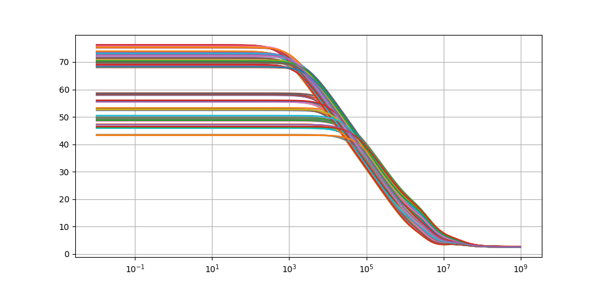
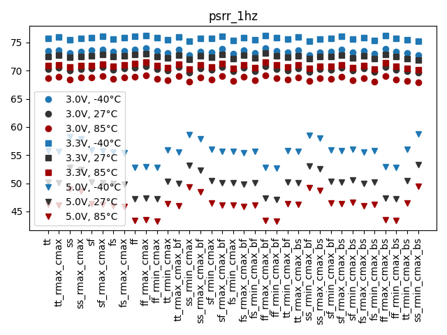
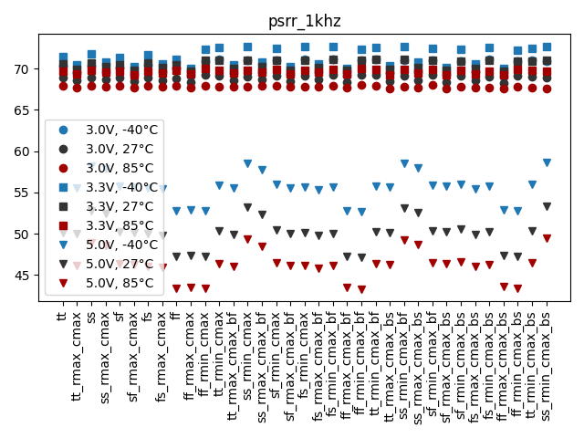
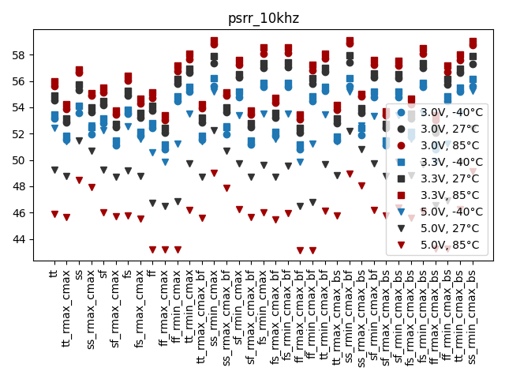
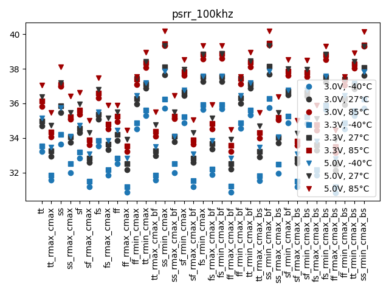
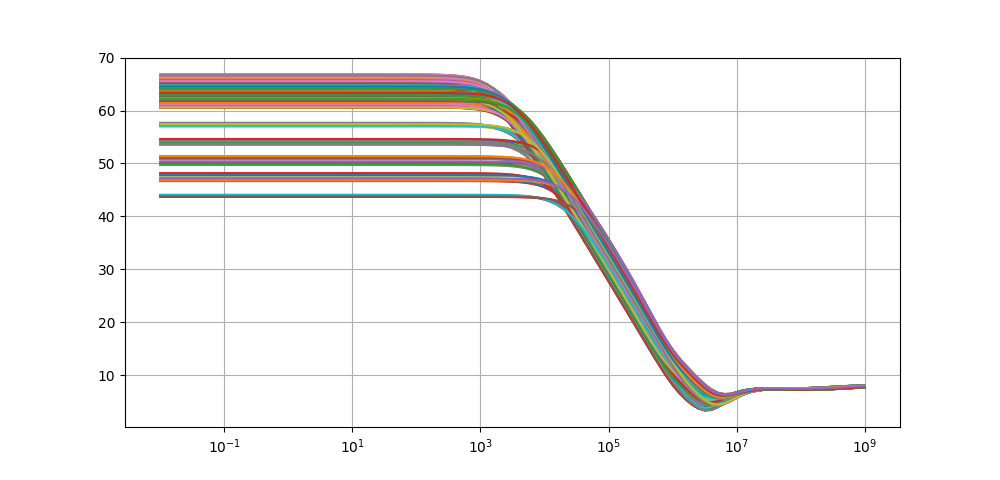
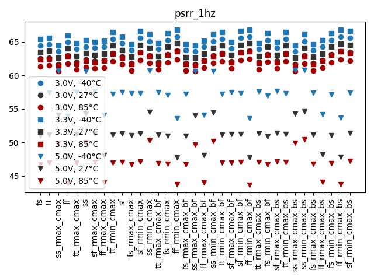
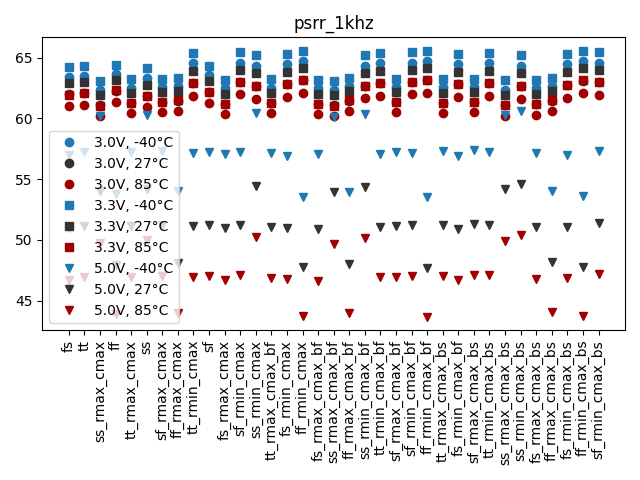
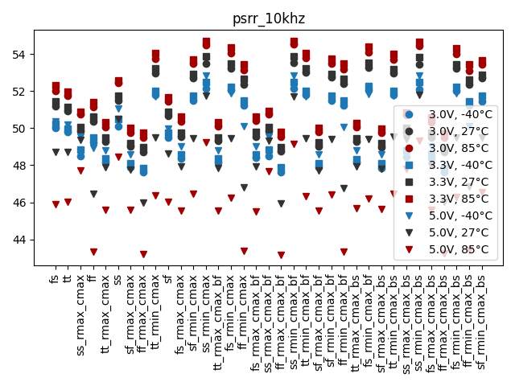
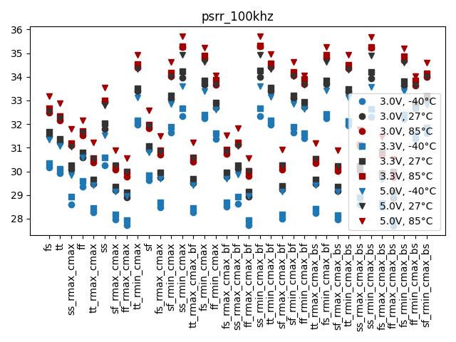

# Simulation Results 

Simulation results for ac_bandgap_psrr

## Pre-Layout Simulation

|             |     min |     max |    mean |      std |
|:------------|--------:|--------:|--------:|---------:|
| psrr_dc     | 43.2743 | 76.2681 | 64.815  | 10.4861  |
| psrr_1hz    | 43.2743 | 76.268  | 64.815  | 10.4861  |
| psrr_1khz   | 43.2731 | 72.7234 | 63.3779 |  9.40062 |
| psrr_10khz  | 43.1398 | 59.1221 | 52.8882 |  3.63072 |
| psrr_100khz | 30.83   | 40.2016 | 35.3806 |  2.22512 |

## Post-Layout Simulation

|             |     min |     max |    mean |     std |
|:------------|--------:|--------:|--------:|--------:|
| psrr_dc     | 43.6697 | 66.8391 | 59.5629 | 6.2578  |
| psrr_1hz    | 43.6697 | 66.8391 | 59.5629 | 6.2578  |
| psrr_1khz   | 43.6662 | 65.5863 | 59.0398 | 5.92961 |
| psrr_10khz  | 43.1665 | 54.7191 | 50.1369 | 2.48477 |
| psrr_100khz | 27.7008 | 35.7216 | 31.6446 | 2.06427 |

