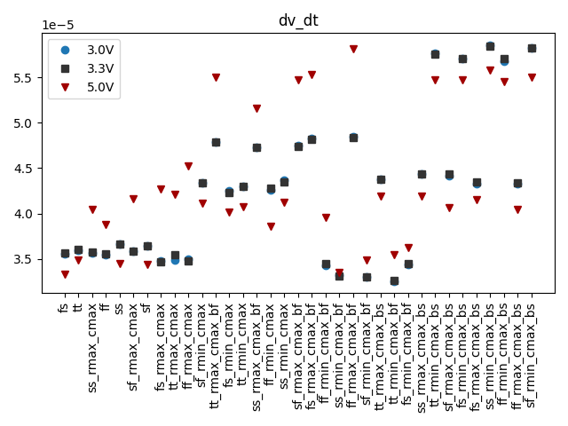
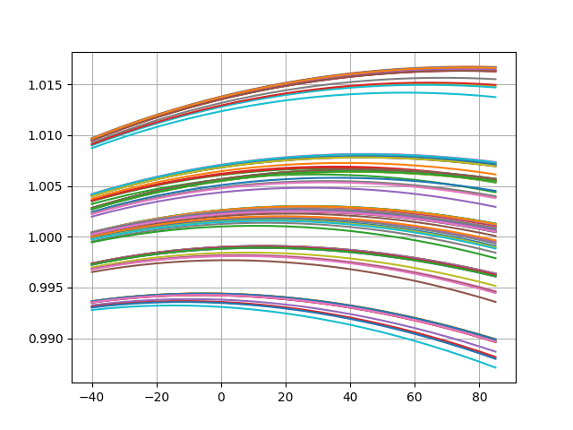
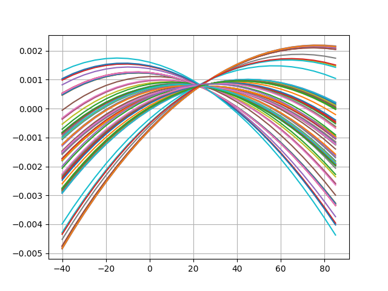

# Simulation Results 

Simulation results for dc_bandgap_temperature

## Pre-Layout Simulation

|       | min       | max       | mean      | std      |
|:------|:----------|:----------|:----------|:---------|
| dv_dt | 20.70302u | 46.48845u | 31.59613u | 7.07938u |

