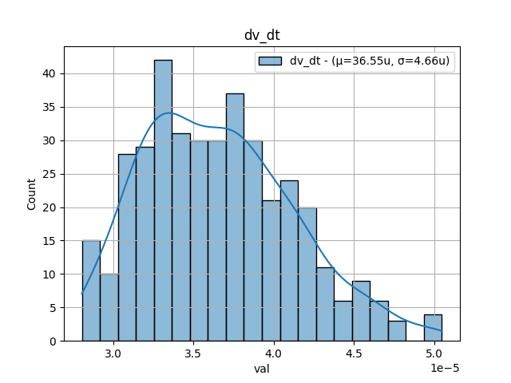
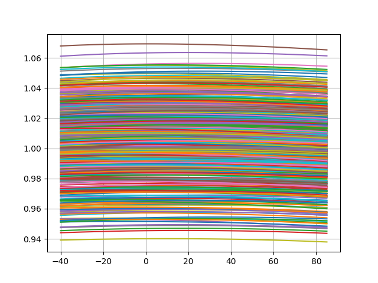
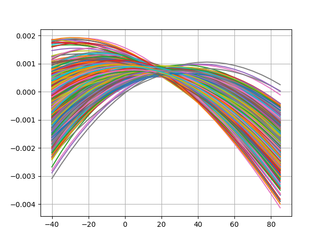
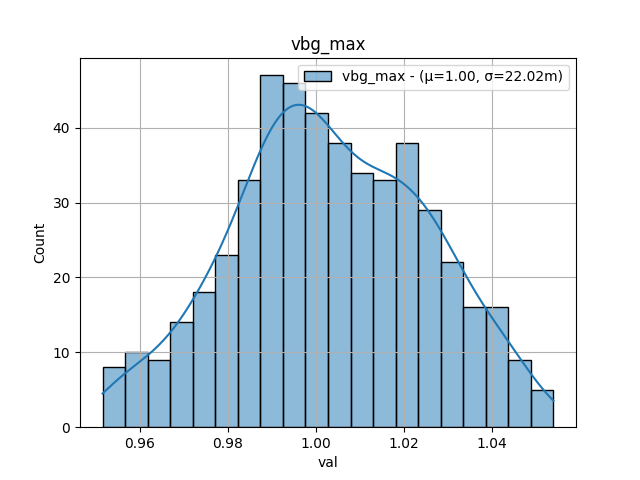

# Simulation Results 

Simulation results for mc_bandgap_temperature

## Pre-Layout Simulation

|         | min       | max       | mean      | std       |
|:--------|:----------|:----------|:----------|:----------|
| vbg_min | 937.9381m | 1.06533   | 1.00014   | 23.14576m |
| vbg_max | 940.1215m | 1.06932   | 1.00306   | 23.24538m |
| dv_dt   | 26.47467u | 54.80452u | 36.60779u | 4.98116u  |

