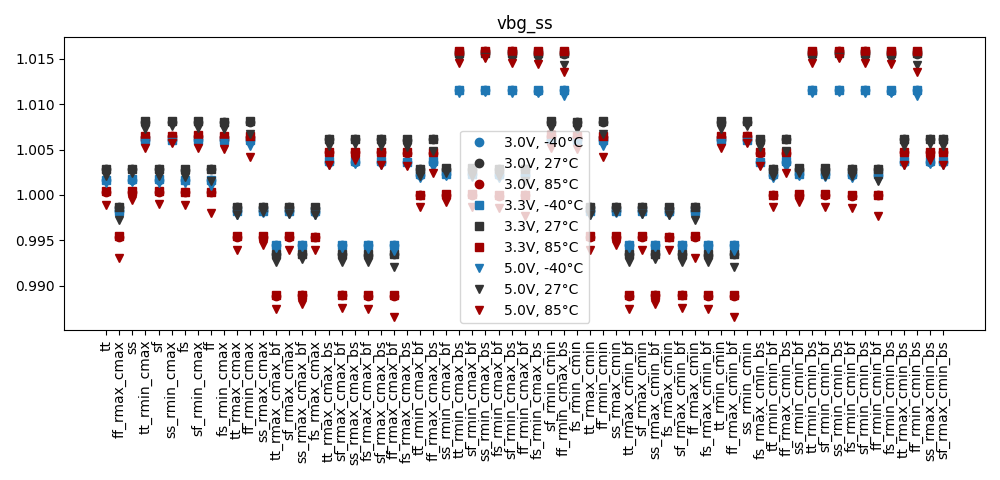
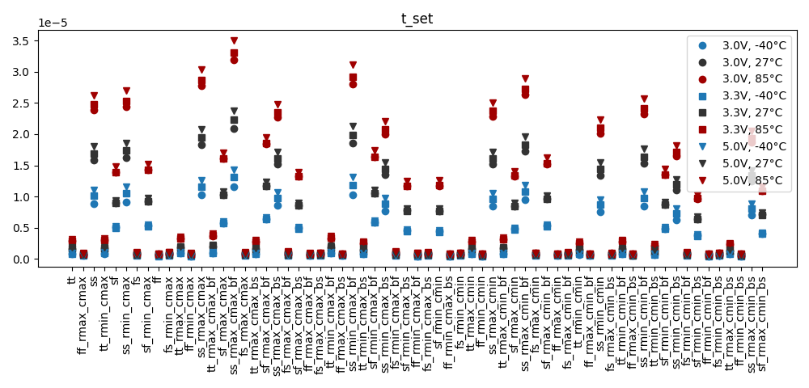
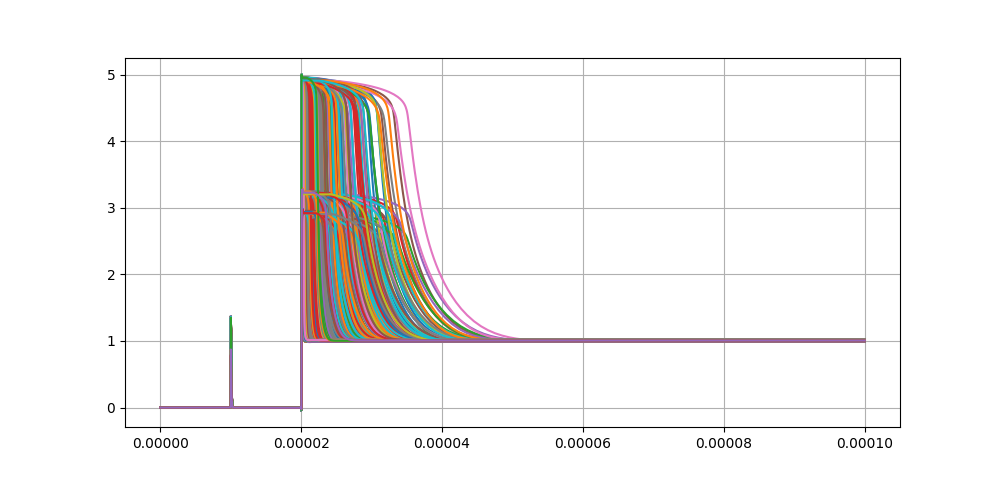
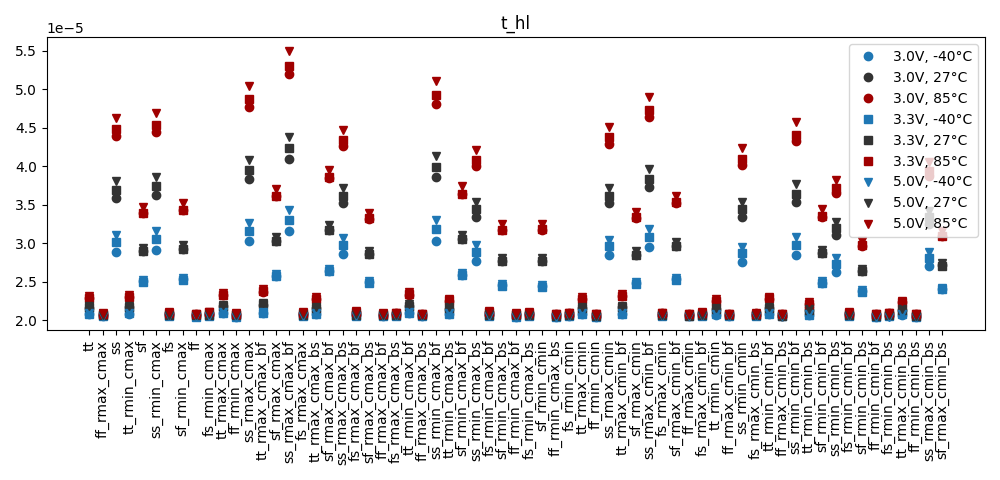
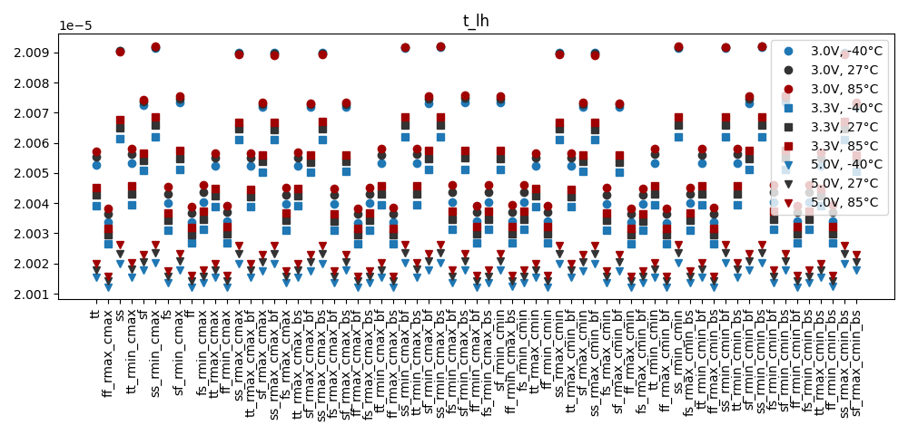
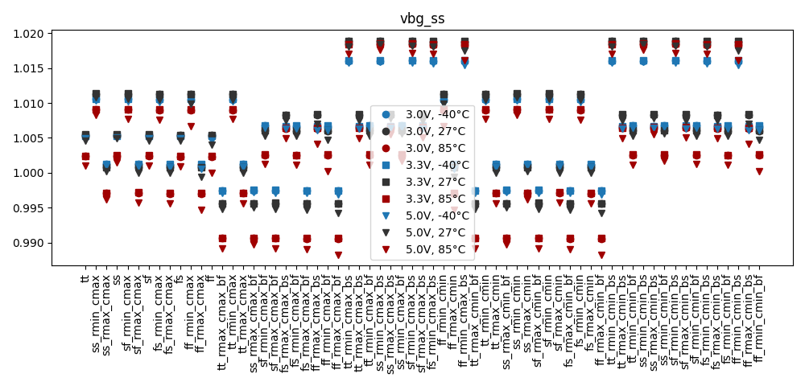
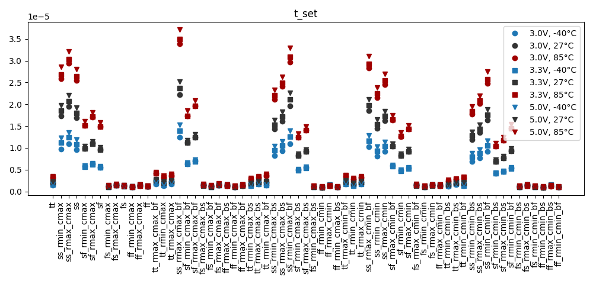
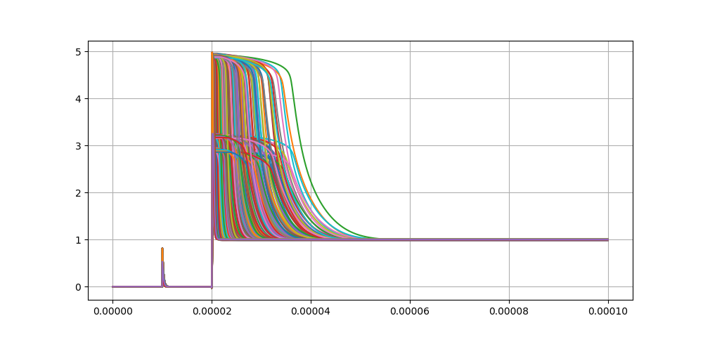
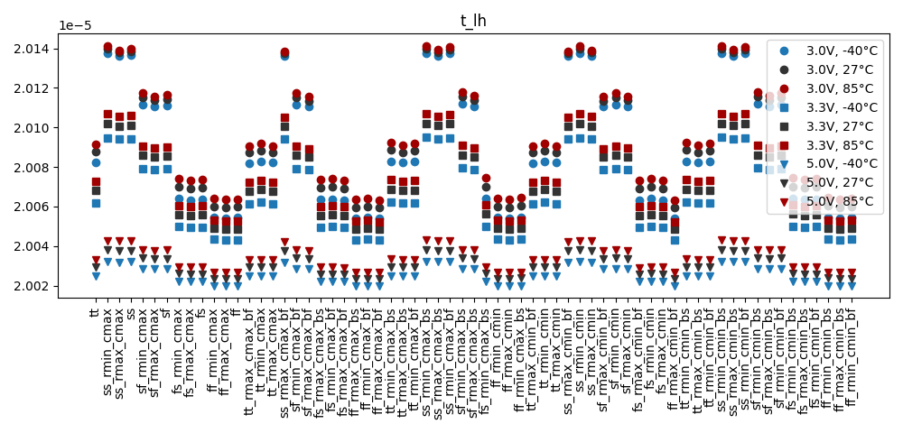

# Simulation Results 

Simulation results for tr_bandgap_startup

## Pre-Layout Simulation

|        | min       | max       | mean      | std       |
|:-------|:----------|:----------|:----------|:----------|
| vbg_ss | 986.566m  | 1.01589   | 1.00251   | 6.94766m  |
| t_set  | 434.0n    | 34.99363u | 5.93533u  | 7.37237u  |
| t_hl   | 20.434u   | 54.99363u | 25.93534u | 7.37237u  |
| t_lh   | 20.01217u | 20.09214u | 20.041u   | 22.18047n |

## Post-Layout Simulation

|        | min       | max       | mean      | std       |
|:-------|:----------|:----------|:----------|:----------|
| vbg_ss | 988.2668m | 1.01890   | 1.00536   | 7.37230m  |
| t_set  | 925.47n   | 37.09564u | 6.64581u  | 7.65994u  |
| t_hl   | 20.92547u | 57.09564u | 26.64582u | 7.65994u  |
| t_lh   | 20.01989u | 20.14131u | 20.06491u | 33.59962n |

