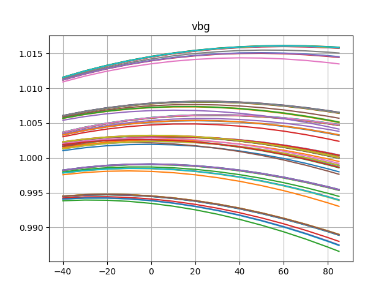
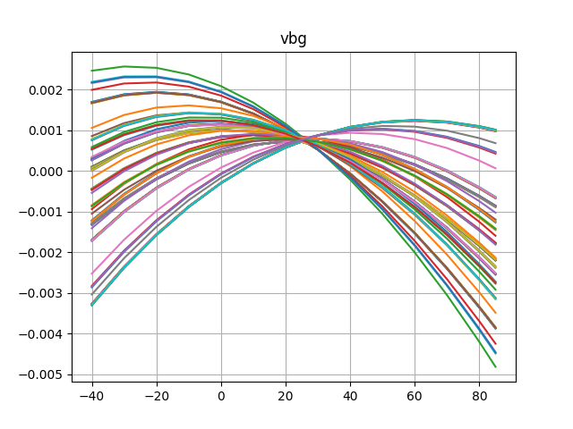
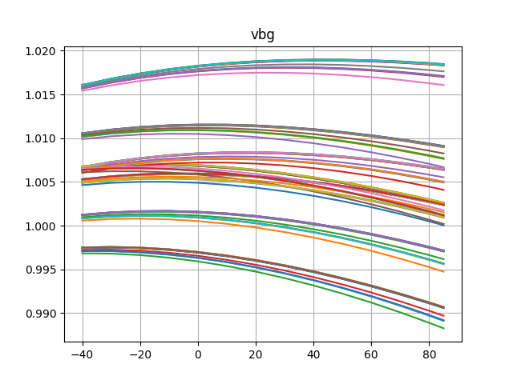
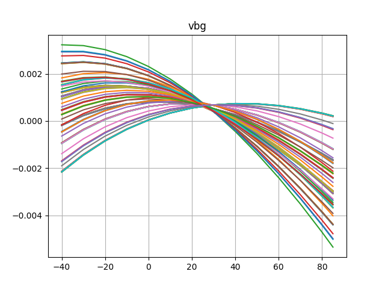

# Simulation Results 

Simulation results for tr_bandgap_temperature

The purpose of this particular testbench is to establish the
correctness of the corresponding .dc testbench.

## Pre-Layout Simulation

## Post-Layout Simulation

