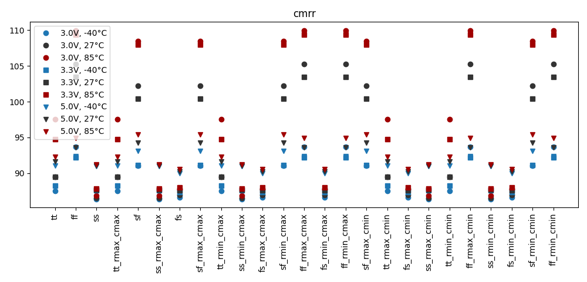
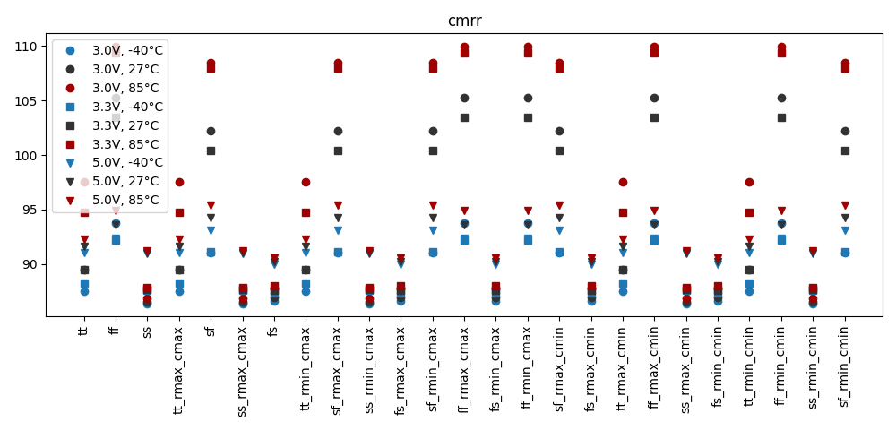

# Simulation Results 

Simulation results for ac_tb_amplifier_cmrr

## Pre-Layout Simulation

|      |     min |     max |    mean |     std |
|:-----|--------:|--------:|--------:|--------:|
| cmrr | 86.3821 | 109.983 | 93.1609 | 6.63915 |

## Post-Layout Simulation

|      |     min |     max |    mean |     std |
|:-----|--------:|--------:|--------:|--------:|
| cmrr | 86.3819 | 109.984 | 93.1623 | 6.64021 |

