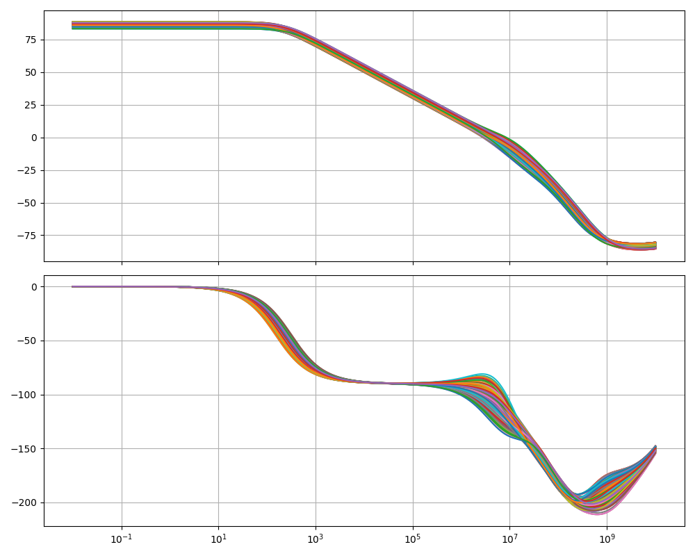
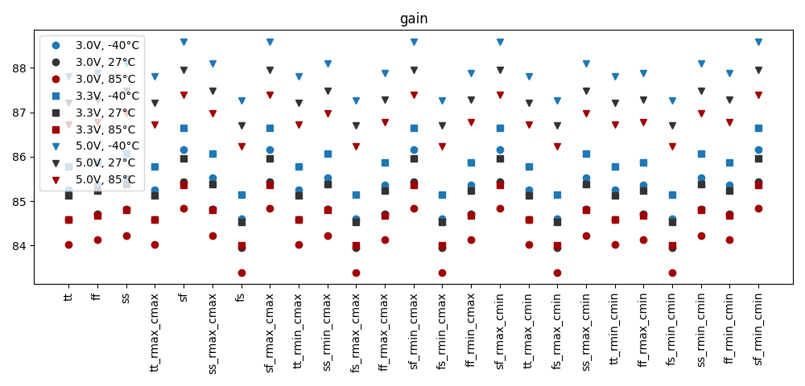
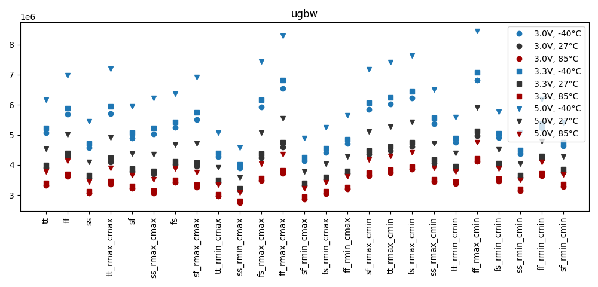
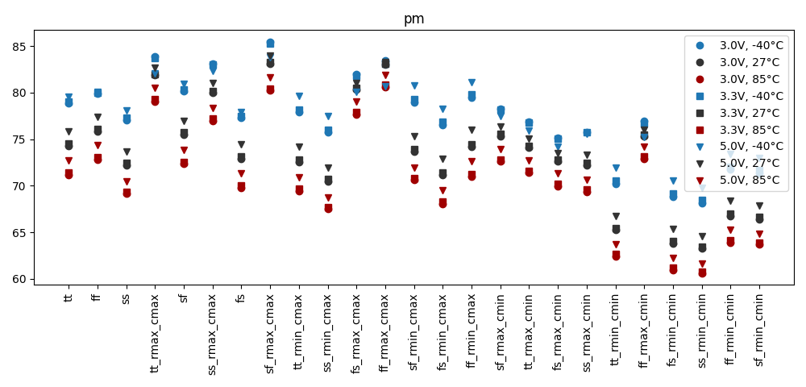
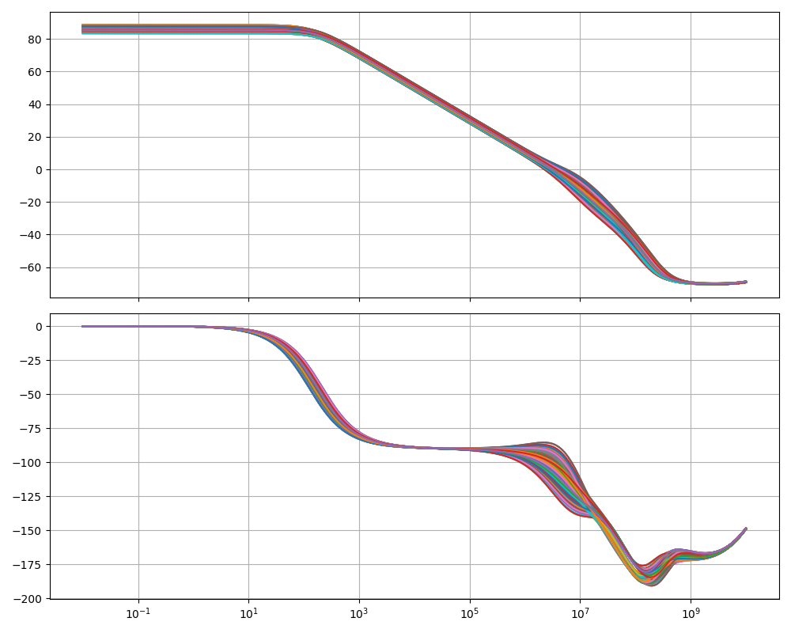
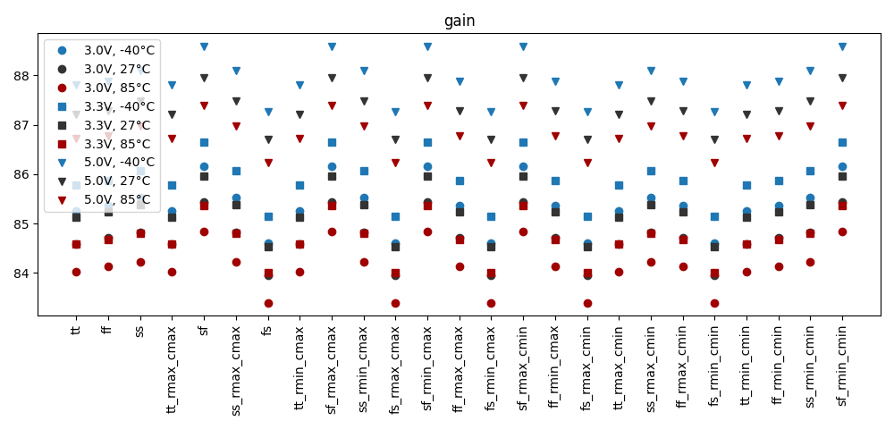
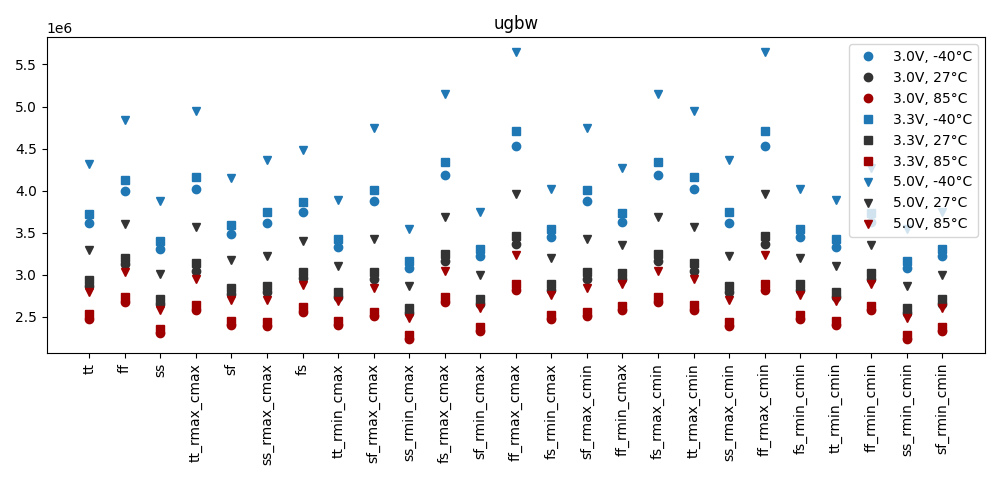
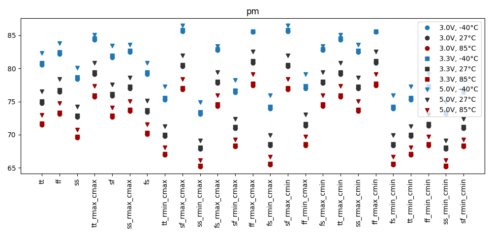

# Simulation Results 

Simulation results for ac_tb_amplifier_stb

## Pre-Layout Simulation

|        | min       | max       | mean      | std      |
|:-------|:----------|:----------|:----------|:---------|
| gain   | 83.39734  | 88.59343  | 85.79415  | 1.31044  |
| ugbw   | 2.74854M  | 8.45753M  | 4.46022M  | 1.11584M |
| pm     | 60.6002   | 85.48193  | 74.16216  | 5.71179  |

## Post-Layout Simulation

|        | min       | max       | mean      | std       |
|:-------|:----------|:----------|:----------|:----------|
| gain   | 83.39712  | 88.59267  | 85.79391  | 1.31040   |
| ugbw   | 2.24063M  | 5.65144M  | 3.21755M  | 688.1264k |
| pm     | 65.1724   | 86.50355  | 75.69985  | 5.57804   |

