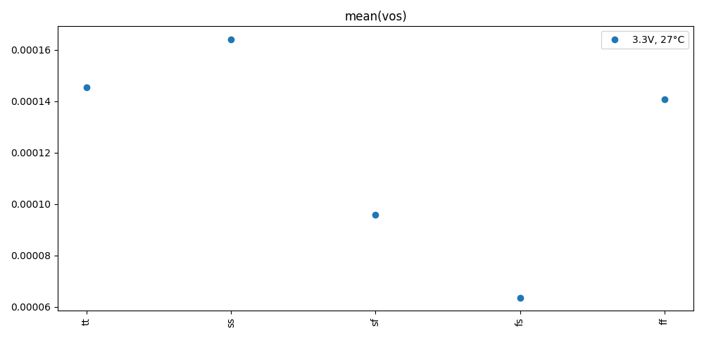
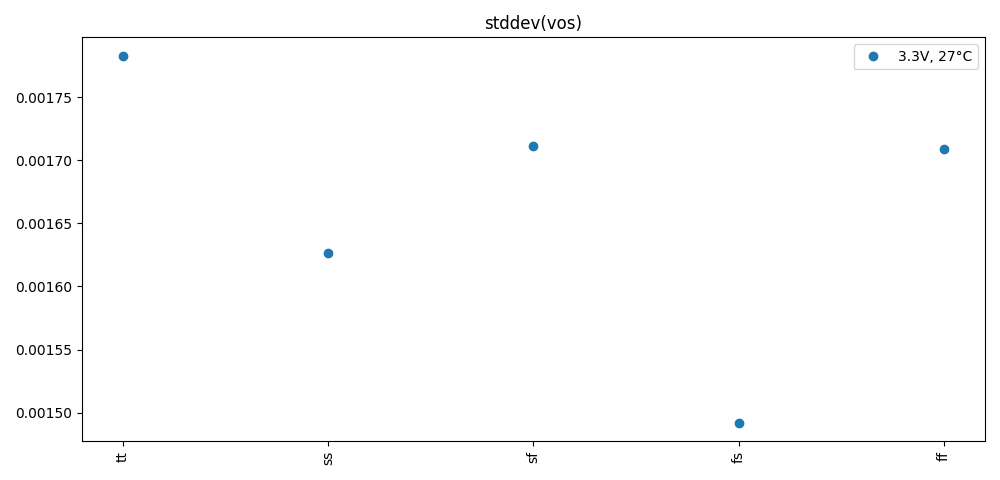
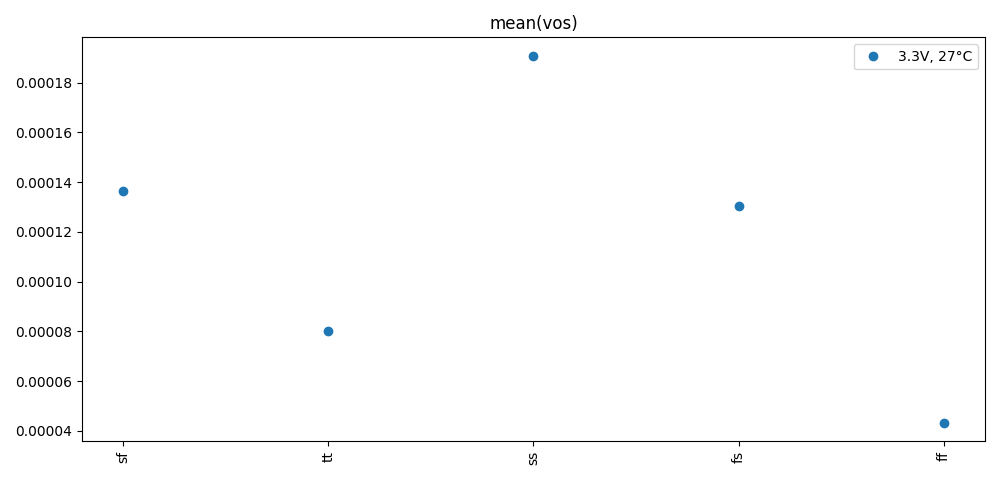
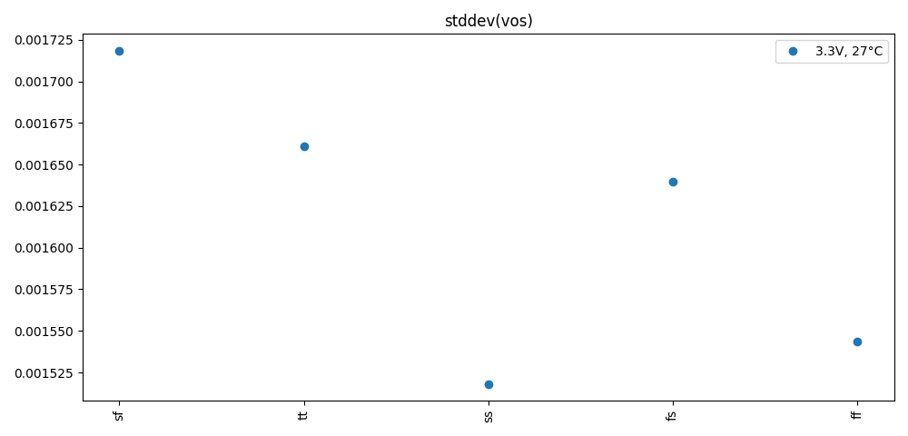

# Simulation Results 

Simulation results for mc_tb_amplifier

## Pre-Layout Simulation

|             | min       | max       | mean      | std       |
|:------------|:----------|:----------|:----------|:----------|
| mean(vos)   | -167.196u | 190.7558u | 52.41151u | 135.7302u |
| stddev(vos) | 1.49211m  | 1.78286m  | 1.66441m  | 99.30603u |

## Post-Layout Simulation

|             | min       | max      | mean      | std       |
|:------------|:----------|:---------|:----------|:----------|
| mean(vos)   | 43.34328u | 190.805u | 116.2974u | 50.56286u |
| stddev(vos) | 1.51810m  | 1.71852m | 1.61618m  | 74.68798u |

